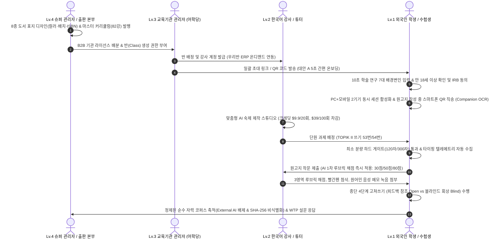
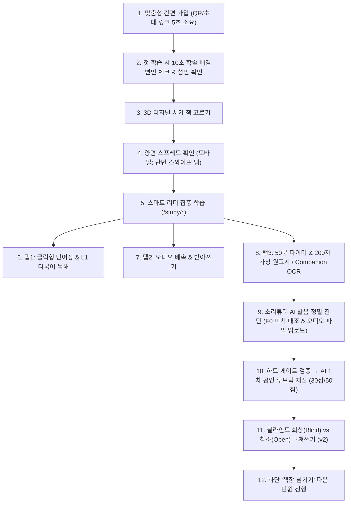
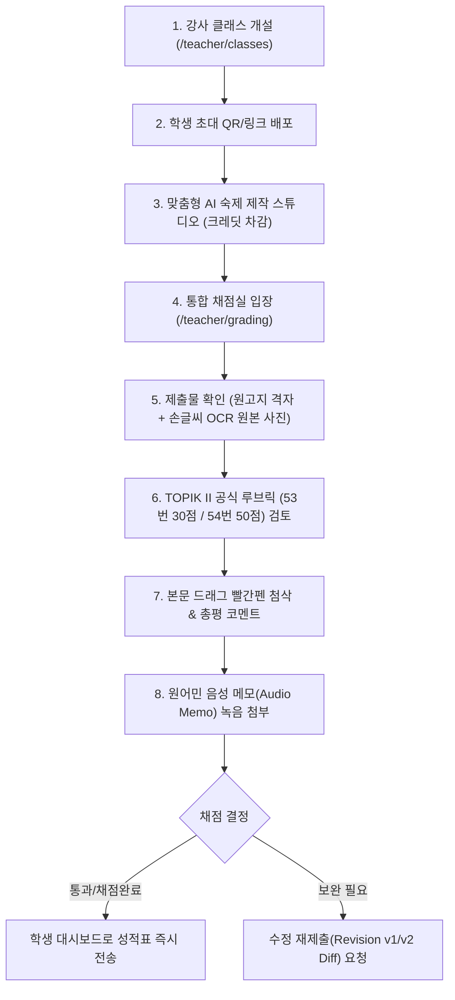
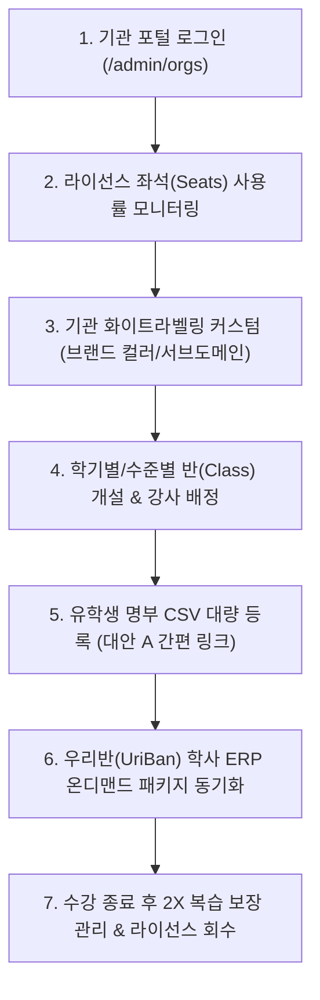
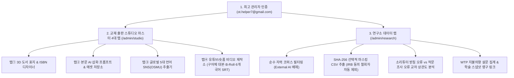
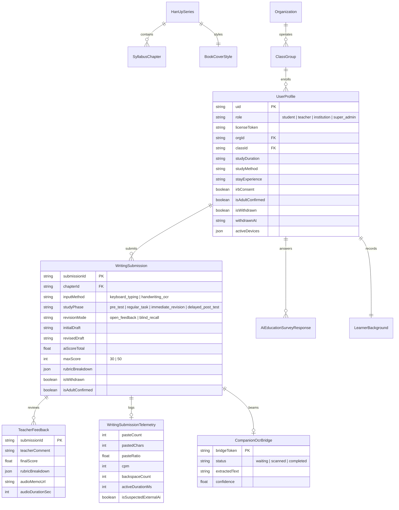

# 한업 (HanUp | 韩升) 스마트 에듀테크 플랫폼 아키텍처 및 역할별 종합 작동 명세서 (v2.3)

> [!NOTE]
> 본 문서는 외국인 유학생 및 수험생을 위한 AI 기반 1:1 맞춤형 한국어 스마트 러닝 플랫폼 **‘한업(HanUp)’**의 전체 시스템 아키텍처와 함께, **학생(Lv.1), 강사(Lv.2), 기관(Lv.3), 관리자(Lv.4)** 4대 주체별 실제 작동 방식(Operational Flow), 입출력 데이터 처리 규격, TOPIK II 공인 채점 기준, 글로벌 수익화 퍼널, **SSCI/KCI급 학술 연구 방법론적 방어 기제(작문 진위 텔레메트리, 종단 4단계 실험, 블라인드 회상 고쳐쓰기, 엄격한 IRB 윤리 준수 및 1-클릭 Opt-out, PC+모바일 동시 세션 Companion OCR, 위챗/샤오홍슈 WebView 방어)**를 집대성한 공식 기술 명세서입니다.

---

## 1. 플랫폼 비전 및 4대 주체 상호작용 구조

한업은 **"실물 출판 교재의 아날로그 물성"**과 **"AI 기반 1:1 스마트 인터랙션"**을 유기적으로 융합한 글로벌 한국어 에듀테크 솔루션입니다. 4대 주체는 플랫폼 내에서 유기적으로 연결되어 데이터를 생성·순환합니다.

---

## 2. 4대 주체별 상세 작동 방식 및 화면 시나리오

---

### 2.1. [Lv.1 학생 (Student)] 작동 방식

외국인 수험생 및 어학연수생이 실제 플랫폼을 이용하는 전 과정입니다.

#### ① 초간편 온보딩, 엄격한 IRB 윤리 준수 & 2기기 동시 세션 ([`/join`](file:///c:/HanUp/src/app/join/page.tsx), [`/dashboard`](file:///c:/HanUp/src/app/dashboard/page.tsx))
- **5초 간편 가입**: 기관 초대 링크/QR 코드를 통해 접속 시 기관명(예: `서울대 언어교육원`), 반(예: `2026 봄학기 정규 3반`), 모국어(L1), 목표 급수가 자동 프리필되어 비밀번호 입력만으로 즉시 가입 완료.
- **10초 학술 배경변인 체크 ([`LearnerBackgroundModal.tsx`](file:///c:/HanUp/src/components/LearnerBackgroundModal.tsx))**:
  - 첫 학습이나 레벨테스트 진입 시 논문 연구에 필수적인 **7대 학술 배경변인**을 비동기 모달로 10초 만에 체크합니다:
    1. **만 18세 이상 확인 (`isAdultConfirmed`: 필수 체크)**: 미성년자 데이터 오염 및 연구 윤리 위반 원천 방어.
    2. **비식별 연구 동의 (`researchConsent`: 선택)**: "동의하지 않거나 철회하더라도 학습 기능에는 어떠한 불이익도 없음"을 명시.
    3. 총 한국어 학습 기간 (`studyDuration`: 6개월 미만, 6개월~1년, 1~2년, 2년 이상).
    4. 주 학습 방식 (`studyMethod`: 대학 어학당, 독학/인강, 현지 학원, 과외).
    5. 한국 체류 경험 (`stayExperience`: 6개월 미만, 1~2년, 2년 이상, 없음).
    6. 모국어 (`nativeLanguage`: 중국어, 베트남어, 영어, 일본어, 몽골어 등).
    7. TOPIK 목표 급수 (`targetLevel`: 3급 ~ 6급) 및 주 입력 모달리티.
- **1-클릭 연구 동의 철회권 (Opt-out, [`/dashboard`](file:///c:/HanUp/src/app/dashboard/page.tsx))**:
  - 학생 마이 대시보드에서 `[🛡️ 연구 데이터 제공 동의 철회(Opt-out)]` 버튼을 언제든 클릭 한 번으로 실행 가능 (`isWithdrawn: true`).
  - 철회 즉시 Lv.4 연구소 데이터 랩 코퍼스 집계 및 CSV/JSON 추출에서 해당 학생의 모든 제출물이 자동 제외됩니다.
- **PC + 모바일 2기기 동시 세션 허용 모델**:
  - 기존의 단일 세션 강제 킥오프로 인한 불편을 해소하고, `1 데스크톱/태블릿 + 1 모바일 스마트폰 (최대 2대)` 동시 세션을 보장하여 PC로 원고지를 쓰며 스마트폰으로 손글씨를 촬영할 수 있도록 지원.

#### ② 3D 디지털 서가 & 모바일 반응형 양면 스프레드 ([`BookshelfSelector.tsx`](file:///c:/HanUp/src/components/BookshelfSelector.tsx))
- **서점 브라우징 감성**: 원목 선반에 꽂힌 **[한업 TOPIK 서가 (4종)]** 및 **[생활한국어 서가 (4단계)]** 8종 교재를 탐색.
- **양면 스프레드 (Two-Page Spread) 모달**:
  - **PC 데스크톱 (768px 이상)**: 좌측에 3D 실물 하드커버 책 표지와 2X 복습 보장 안내, 우측에 전체 목차(TOC)와 `[1강 무료 펼쳐보기]`가 나란히 펼쳐짐.
  - **모바일 웹 (768px 미만, 위챗/샤오홍슈 인앱 브라우저 최적화)**: 좁은 세로 화면에서 글자가 깨지지 않도록 `[📘 표지 & 스펙]`과 `[📑 단원 목차]` 상단 세그먼트 탭으로 자동 분리되어 부드러운 스와이프 카드 뷰로 전환.

#### ③ 스마트 리더 집중 학습, 원고지 및 실전 수험 방어 ([`/study/[seriesId]/[chapterId]`](file:///c:/HanUp/src/app/study/[seriesId]/[chapterId]/page.tsx))
- **위챗·샤오홍슈 인앱 브라우저 감지 배너 ([`InAppBrowserBanner.tsx`](file:///c:/HanUp/src/components/InAppBrowserBanner.tsx))**:
  - MicroMessenger(WeChat) 또는 Xiaohongshu 인앱 브라우저 감지 시 상단에 "우측 상단 [···] ➔ 기본 브라우저(Safari/Chrome)로 열기" 배너를 노출하여 WebRTC 마이크 및 다운로드 권한 차단 사전 예방.
- **스마트폰 QR 사진 직송 브릿지 ([`CompanionOcrModal.tsx`](file:///c:/HanUp/src/components/CompanionOcrModal.tsx))**:
  - PC 원고지 화면에서 `[📷 QR 스마트폰 직송 (Companion)]` 클릭 시 보안 세션 토큰이 담긴 QR 코드 모달 팝업.
  - 스마트폰 카메라로 스캔하여 손글씨 원고지를 촬영하면 PC 에디터로 실시간 전송되어 원고지 텍스트로 즉시 반영.
- **한글 IME 조합 깨짐 방지 Virtual Grid & 최소 분량 하드 게이트**:
  - 한글 타이핑 도깨비불 현상(자모 분리)을 방지하기 위해 단일 투명 `<textarea>`와 20칸 가상 격자를 완벽히 동기화.
  - **최소 분량 하드 게이트 (Hard Gate)**: 53번(도표 분석) 120자 미만, 54번(찬반 논술) 300자 미만 제출 시 AI 분석 호출을 원천 차단하고 분량 보강 경고 배너 표출 (불량 코퍼스 방지 및 API 비용 절감).
- **학술 심사용 작문 진위 텔레메트리 (Keystroke Telemetry Live Monitor)**:
  - 외부 AI(ChatGPT, 파파고) 복사-붙여넣기 오염을 방지하기 위해 `pasteCount`, `pastedChars`, `pasteRatio`, `cpm`(분당 타자 속도), `backspaceCount`(수정 횟수), `activeDurationMs`(실제 소요시간)를 실시간 로깅.
  - 비정상 패턴(붙여넣기 40% 초과 또는 수정 없이 550타 초과) 감지 시 `isSuspectedExternalAi: true` 플래그 자동 부여.
  - 학습자 스스로 외부 복사를 방지할 수 있는 `[🔒 외부 붙여넣기 차단]` 토글 지원.
- **소리튜터 AI 발음 클리닉 & 오디오 파일 직접 업로드 폴백 ([`SoriTutorModal.tsx`](file:///c:/HanUp/src/components/SoriTutorModal.tsx))**:
  - 원어민 표준 음성의 F0 피치 곡선과 학습자 녹음 곡선을 실시간 중첩 대조.
  - 위챗 인앱 등 WebRTC 마이크 차단 환경을 위해 `[📁 휴대폰 음성 녹음 파일(.m4a/.mp3/.wav) 직접 업로드]` 폴백 탑재.
- **종단 연구 4단계 실험 태깅 및 블라인드 고쳐쓰기 (Blind Recall)**:
  - 실험 단계 태그(`studyPhase: 'pre_test' | 'regular_task' | 'immediate_revision' | 'delayed_post_test'`).
  - 고쳐쓰기 조건(`revisionMode: 'open_feedback' | 'blind_recall'`).
  - 블라인드 회상 모드 활성화 시 AI 및 교사 피드백 창이 불투명 마스킹(Frosted Glass Mask)되어, 단순 모방 복사를 방지하고 장기 기억 및 문법 내재화 효과를 엄밀히 측정.

---

### 2.2. [Lv.2 개인 강사 (Teacher/Tutor)] 작동 방식

개인 튜터 및 대학 어학당 강사가 학생들을 코칭하고 채점하는 흐름입니다.

#### ① 클래스 개설 및 수강생 관리 ([`/teacher/classes`](file:///c:/HanUp/src/app/teacher/classes/page.tsx))
- **클래스 개설**: 목표 교재를 지정하여 분반 생성 및 초대 링크/QR 원클릭 배포.
- **우리반 ERP 온디맨드 아코디언**: 기본 비활성(접힘) 상태로 유지되며, 학사 데이터 동기화가 필요할 때만 토글로 활성화하여 포트 충돌 없이 안전하게 사용.
- **맞춤형 AI 숙제 제작 스튜디오**: 교사가 학생들의 취약점을 바탕으로 맞춤형 연습 문제를 생성하며, 유료 크레딧($9.9/20회, $39/100회)이 차감됩니다. (Lv.1 학생의 임의 생성은 엄격히 차단)

#### ② 원고지 작문 & 발음 통합 채점실 ([`/teacher/grading`](file:///c:/HanUp/src/app/teacher/grading/page.tsx))
- **제출 큐 필터링**: [채점 대기], [채점 완료], [재제출 요청].
- **TOPIK II 실제 시험 배점 규격 분리 적용**:
  - **53번 도표 분석 채점 모드**: 30점 만점 (과제 수행 7점 / 전개 구조 7점 / 언어 사용 16점) 슬라이더.
  - **54번 찬반 논술 채점 모드**: 50점 만점 (과제 수행 12점 / 전개 구조 12점 / 언어 사용 26점) 슬라이더.
  - 쓰기 총점 80점 환산 표기.
- **인라인 빨간펜 첨삭**: 틀린 조사나 어휘를 드래그하여 교정 문구 입력.
- **원어민 음성 메모 (Audio Memo) 녹음**:
  - 교사가 마이크 버튼을 눌러 최대 60초간 음성 피드백을 직접 녹음하여 전송 (`teacher_feedback_voice.mp3`).
  - 학생 화면에 재생 플레이어가 노출되어 뉘앙스와 억양을 실시간 청취 가능.
- **재제출(Revision) v1/v2 비교 뷰어**: 수정 요청된 과제의 이전 제출본과 수정본을 좌우 나란히 대조(Diff)하며 첨삭.

---

### 2.3. [Lv.3 교육기관 관리자 (Institution)] 작동 방식

대학 언어교육원, 한국어학당, 대형 유학원 관리자가 대규모 학생과 강사를 총괄하는 흐름입니다.

#### ① 기관 및 좌석(Seats) 화이트라벨링 관리 ([`/admin/orgs`](file:///c:/HanUp/src/app/admin/orgs/page.tsx))
- **기관 브랜딩 커스터마이징**: 기관 고유의 메인 브랜드 컬러(Primary Color)와 서브도메인을 지정하여 전용 러닝 포털 제공.
- **좌석(Seats) 쿼터 관리**: 등록된 총 학생 수 대비 잔여 시트 현황을 실시간 게이지 바로 확인 및 추가 라이선스 구매.

#### ② 우리반(UriBan) 학사 ERP 온디맨드 연동 ([`UriBanSyncModal.tsx`](file:///c:/HanUp/src/components/UriBanSyncModal.tsx))
- **포트 3001 격리 및 온디맨드 토글**: 기본 상태에서는 외부 연결이 차단되어 한업 단독 실행 시 불필요한 네트워크 에러나 포트 충돌이 원천 차단됩니다.
- **양방향 패키지 동기화**: 관리자가 토글을 켰을 때만 학생 명부, 출결 현황, 과제 제출 로그를 JSON 패키지로 내보내거나 가져옵니다.

---

### 2.4. [Lv.4 슈퍼 관리자 / 출판 본부 (Super Admin)] 작동 방식

한업 본사, 출판부, 수석 연구원이 교재를 출판하고, 전역 설정을 제어하며, 연구 데이터를 수집하는 최고 권한 흐름입니다.

#### ① Lv.4 교재 출판 스튜디오 마스터 4대 탭 ([`/admin/studio`](file:///c:/HanUp/src/app/admin/studio/page.tsx))
상단 마스터 탭을 통해 4가지 핵심 기능이 누락 없이 완벽히 공존합니다:
1. **탭 ① `📘 3D 도서 표지 & ISBN 디자이너`**:
   - 8종 시리즈(TOPIK 4종 + 생활한국어 4단계) 실시간 표지 편집.
   - 메인 테마 색상, 3종 레이아웃(헤더형/엠블럼형/좌측정렬), 표지 질감(무광 매트/유광/가죽).
   - 저자명, 출판사명, ISBN 코드, 정가 실시간 수정 및 3D 하드커버 뷰어/전역 서가 동기화.
   - 출판소 납품용 300DPI 인쇄용 A4 PDF 내보내기 지원.
2. **탭 ② `🎨 본문 AI 삽화 프롬프트 & 에셋 저장소`**:
   - 82개 단원별 상황에 맞는 AI 이미지 생성 프롬프트(Midjourney/DALL-E) 자동 생성.
   - 단원별 삽화 에셋 클라우드 저장 및 스마트 리더 본문 즉시 배치.
3. **탭 ③ `📱 글로벌 5대 언어 SNS(OSMU) 마케팅 추출기`**:
   - 단원 핵심 어휘와 문법을 **샤오홍슈(중국어 간체), 인스타그램, 틱톡**용 3:4 카드뉴스 CSV로 일괄 추출.
   - 40초 숏폼 릴스/쇼츠 대본 및 다국어(한국어, 중국어, 베트남어, 영어, 일본어) 자막 스크립트 원클릭 다운로드.
4. **탭 ④ `🎥 유튜브/숏폼 강의 비디오 제작소 ([YouTubeVideoStudio.tsx](file:///c:/HanUp/src/components/YouTubeVideoStudio.tsx))` (NEW)**:
   - **강의형 구어체 대본 변환기**: 교재 문어체 본문(개념·문법·루브릭)을 유튜버나 1타 강사가 카메라 앞에서 설명하듯 친근한 구어체("안녕하세요 여러분! 오늘은~", "여기서 주의할 점은~") 대본으로 실시간 변환 (3대 톤앤매너: 친근한 1:1 과외, 카리스마 1타 강사, 차분한 쉐도잉 / 3대 재생 시간: 60초 숏폼, 3분 마이크로 특강, 8분 실전 해설).
   - **컷(Scene) 분할 및 시각 자료(B-Roll) 매핑**: 씬 단위 타임코드(`00:00 - 00:15` 등), 강사 음성 대본(Voiceover), 화면 표출 자막, B-Roll 시각 자료(3초 스키밍 형광펜, 54번 템플릿, 20칸 가상 원고지, 3D 교재 팝업, SoriTutor F0 피치 곡선) 및 오디오 SFX 효과음 큐를 구조화된 스토리보드로 렌더링.
   - **유튜브 글로벌 SEO 다국어 자막(SRT/VTT) 자동 추출 & YouTube Studio 키트**: 6개 국어(KO, EN, JA, ZH, VI, MY) 표준 타임코드 자막 파일(`.srt` / `.vtt`) 개별 및 6개 국어 일괄 다운로드, 언어별 유튜브 클릭률(CTR) 최적화 제목, 타임스탬프 챕터가 포함된 영상 설명란 템플릿, 검색 태그 원클릭 복사 지원.

#### ② 연구소 데이터 랩 & 학술 연구 파이프라인 ([`/admin/research`](file:///c:/HanUp/src/app/admin/research/page.tsx))
- **순수 자력 작문 코퍼스 필터링 ([`[✅ 순수 자력 작문만 필터링]`])**:
  - 외부 번역기나 대필 의심(`isSuspectedExternalAi: true`) 데이터를 원클릭으로 필터링하여 순수 인간 학습자의 실제 오류 코퍼스만 추출.
- **엄격한 IRB 윤리 준수 (동의 철회자 자동 제외)**:
  - 동의를 철회한 학습자(`isWithdrawn === true`)는 전체 통계, 코퍼스 테이블, CSV/JSON 내보내기에서 원천 제외.
- **SHA-256 선택적 비식별화 CSV 추출기**:
  - 학생 개인정보(이름, 이메일)를 SHA-256 해시 또는 마스킹(`김**`, `ot***@***`)하여 연구용 작문 코퍼스 CSV 즉시 추출.
  - CSV 헤더에 `StudyPhase`, `RevisionMode`, `Telemetry_PasteCount`, `Telemetry_PastedChars`, `Telemetry_PasteRatio`, `Telemetry_CPM`, `Telemetry_Backspaces`, `Telemetry_DurationSec`, `Telemetry_SuspectedExternalAi`, `IsAdultConfirmed`, `IsWithdrawn` 완벽 포함.
- **소리튜터 종성(받침) 발음 오류 vs 작문 조사 오류 교차 상관도 분석**:
  - 유학생의 음향학적 종성 발음 오류(예: 'ㄹ/ㄴ', 'ㄱ/ㅂ' 미파음화 탈락)와 한국어 작문 시 조사 오류(예: '은/는', '을/를', '이/가') 간의 통계적 상관계수($r$) 및 히트맵을 시각화하여 음운론-형태론 연계 학술 연구 지원.
- **WTP(지불의향) 설문 분석 및 학술 스냅샷 공유 ([`/research/share/[snapshotId]`](file:///c:/HanUp/src/app/research/share/[snapshotId]/page.tsx))**:
  - AI 단독 vs 인간 교사 첨삭에 대한 유학생 지불 의향 가격대($) 분포 분석 및 논문 인용용 영구 링크(APA 7th 형식) 발급.

---

## 3. 수익화 퍼널 (Monetization Funnel) & 글로벌 결제 규격

한업은 B2C 유학생 결제와 B2B 교육기관 라이선스 모델을 결합한 3단계 하이브리드 수익화 구조를 운영합니다.

| 구분 | 무료 체험 (Free Tier) | 한업 정규 교재 패키지 (Paid) | 소리튜터 단독 구독 (SoriTutor) | B2B 기관 라이선스 (Org Seats) |
| :--- | :--- | :--- | :--- | :--- |
| **가격** | \$0 (무료 회원가입) | 권당 \$19.99 ~ \$29.99 | 월 \$4.99 / 연 \$39.99 | 좌석당 \$15 ~ \$25/학기 |
| **약점 클리닉** | 데일리 3제 무료 체험 | **120제 전체 무제한 해금** | 기본 진단 모드 | 반별 맞춤 문항 세트 |
| **AI 첨삭/OCR** | 일일 2회 제한 | 교재 수강 기간 무제한 | - | 기관 쿼터 일괄 제공 |
| **복습 보장 기간** | - | **수강 기간의 2배 (2X 보장)** | 구독 유지 기간 | 학기 종료 후 6개월 |
| **소리튜터 혜택** | 맛보기 발음 3회 | **해당 교재 발음 교정 무료 무제한** | 전 영역 F0 피치 진단 | 기관 학생 전원 기본 제공 |
| **크로스 할인** | WTP 설문 시 **20% 쿠폰** (`HANUP20WTP`) | 타 시리즈 구매 시 20% 할인 | **한업 교재 구매 시 30% 크로스 할인** | 100석 이상 30% 볼륨 할인 |
| **숙제 생성 권한** | 차단 (학생 생성 불가) | - | - | 교사용 크레딧 (\$9.9/20회, \$39/100회) |

- **글로벌 결제 모달 ([`LemonSqueezyCheckoutModal.tsx`](file:///c:/HanUp/src/components/LemonSqueezyCheckoutModal.tsx))**:
  - Lemon Squeezy 기반 글로벌 신용카드, PayPal, Alipay, WeChat Pay 지원.
  - WTP 설문 응답 완료 시 발급되는 `HANUP20WTP` 프로모션 코드를 입력하면 즉시 20% 결제 금액 할인 적용.

---

## 4. 모바일 반응형 UX 최적화 규격 (WeChat / Xiaohongshu 인앱 브라우저)

샤오홍슈와 위챗 등 모바일 메신저 인앱 브라우저를 통해 접속하는 유학생(모바일 트래픽 80% 이상)을 위해 다음 모바일 뷰포트 최적화가 적용되어 있습니다:

1. **인앱 브라우저 감지 및 외부 브라우저 탈출 가이드 ([`InAppBrowserBanner.tsx`](file:///c:/HanUp/src/components/InAppBrowserBanner.tsx))**:
   - WeChat, Xiaohongshu 환경에서 상단에 탈출 안내 배너를 자동 노출하여 WebRTC 녹음 차단과 PDF 다운로드 제한 방어.
2. **모바일 오디오 파일 직접 업로드 폴백**:
   - 마이크 WebRTC 권한이 제한된 모바일 브라우저에서도 휴대폰 음성 녹음 파일(`.m4a`, `.mp3`, `.wav`)을 직접 올려 소리튜터 발음 교정을 받을 수 있도록 구현.
3. **3D 서가 모달 단면 스와이프 탭 (Viewport < 768px)**:
   - PC 화면의 양면 펼침(Two-Page Spread)이 모바일에서는 상단 `[📘 표지 & 스펙]`과 `[📑 단원 목차]` 세그먼트 버튼으로 자동 전환되어 가로 스크롤 잘림 현상 방지.
4. **반응형 20칸 한국어 가상 원고지 뷰어**:
   - 모바일 좁은 폭에서도 20칸 원고지 규격이 깨지지 않도록 가상 격자 렌더링 및 터치 가로 스크롤 지원.

---

## 5. 플랫폼 데이터 모델 및 스키마 관계도

---

## 6. 결론 및 향후 기술 로드맵

1. **검증된 무결성**:
   - Next.js 14 App Router 기반 전체 16개 라우트 정적 빌드(`npm run build`) 통과 및 TypeScript 타입 안정성 100% 확보.
2. **SSCI/KCI 학술 연구 방법론적 완결성**:
   - 단순 AI 첨삭 서비스에 그치지 않고, 외부 AI/번역기 복사 오염을 방어하는 Keystroke Telemetry를 구축했습니다.
   - 종단 4단계 실험 태깅과 블라인드 회상(Blind Recall) 고쳐쓰기 모드로 장기 기억 및 문법 내재화 효과 검증을 지원합니다.
   - 엄격한 만 18세 이상 성인 학습자 확인 및 1-클릭 연구 동의 철회권(Opt-out)을 보장하여 IRB 연구 윤리 기준을 충족했습니다.
3. **글로벌 수험 및 B2B 상용화 준비 완료**:
   - PC+모바일 2기기 동시 세션과 Companion OCR 브릿지, 위챗/샤오홍슈 WebView 방어로 실제 다국적 수험생들의 실사용 환경을 보호합니다.
   - Lemon Squeezy, 소리튜터 크로스 혜택, 교사 숙제 크레딧으로 지속 가능한 글로벌 수익 모델을 완비했습니다.
